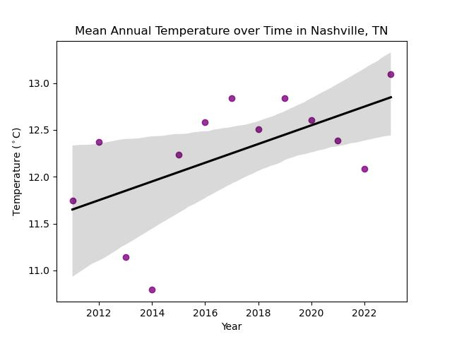

# Alexa Papanikolaou 
This is a page for assignments in the Earth Data Analytics program at CU Boulder

This is my dog, Meli!

  

 

**Bio:** Alexa works in Venture Development with the Venture Partners team at CU Boulder. She has  experience supporting university-based entrepreneurship, research commercialization and venture development, combined with a background in social and environmental impact assessment. Alexa is passionate about supporting innovation for impact, and her personal projects have spanned public transit equity research, community food sovereignty, agriculture tech, sustainable fashion tech and product lifecycle sustainability. Before joining CU Boulder, she earned her Bachelors from Vanderbilt University where she also worked at the Innovation Center, supporting regional entrepreneurial ecosystem development and led the annual Mid-South Innovation Summit, bringing together investors, founders and industry partners.

**Contact Information:**
* Email address: alexa.papanikolaou@colorado.edu
* [Github Profile](https://github.com/alexapapanikolaou)
* [LinkedIn](https://www.linkedin.com/in/alexa-papanikolaou-29765410b/)

## **PROJECTS**

### My First Map Assignment 
This is the example map of the Haskell Indian Nations University 
<embed type="text/html" src="img/haskell.html" width="600" height="600">

This is a map of the Cuyahoga Valley National Park near where I grew up in Ohio!
<embed type="text/html" src="img/CuyahogaValleyNationalPark.html" width="600" height="600">

This is a picture of the Cuyahoga Valley National Park.

          
<small>
    Source: <a href="https://www.travelandleisure.com/thmb/-kEeVgtun3ErUY0kgi9eOYySi7g=/1500x0/filters:no_upscale():max_bytes(150000):strip_icc()/TAL-lead-image-CUYAHOGANP0425-c7aff5cabdaa45d4bed5709f8e26b4d1.jpg">TravelandLeisure.com</a>
  </small>

## Temperature Data Project  
[View the full rendered html notebook here.](portfolio_posts/06-nashville-notebook.html) 
 

**Nashville Temperature Interactive Plot**  
 
<embed type="text/html" src="img/nashville_annual_temp_interactive.html" width="500" height="300">

**Nashville Temperature Trendline Plot**  
 

  

The graphs above show the mean annual average temperature in Nashville, Tennessee, from 2011 to 2023. The temperature data were retrieved from NOAA’s National Centers for Environmental Information (NCEI) Daily Summaries dataset for weather station USC00406403. One important limitation is that these data represent only one weather station in the Nashville area, so they may not fully represent temperature patterns across the entire city. I focused on 2011–2023 because the earlier annual values in the dataset were missing. I also excluded 2024 because the dataset contained only one observation for that year, January 1, which produced an annual average of just 1.67°C and would have drastically skewed the trendline.  
 
Across the available years, the trendline has a slope of approximately 0.10°C per year, which is about 1°C or 1.8°F per decade. This general warming trend is consistent with NOAA’s broader findings for Tennessee, which show that temperatures have increased by more than 2°F since the cooler period of the 1960s and that temperatures since 2010 have been near historically high levels in the state (Runkle, 2022).  
 
Since 2000, Tennessee has received 33 major disaster declarations involving severe storms and flooding. "Extreme weather events that frequently occur in Tennessee include severe thunderstorms, flooding, tornadoes, droughts, heat and cold waves, and winter storms" (Runkle, 2022). For example, in January, 2026 Winter Storm Fern brought one of the region's worst power outages and led 5 storm-related deaths in Nashville and 25 deaths across the state (Turner, 2026). According to The Science Times, "this extreme winter weather demonstrates precisely what scientists have been predicting for decades: a warming planet creates more volatile conditions, including paradoxically intense winter storms" (Soliman, 2026).  

**Bibliography**
 
* Runkle, J., K.E. Kunkel, D.R. Easterling, L.E. Stevens, B.C. Stewart, R. Frankson, L. Romolo, J. Nielsen-Gammon, T.A. Joyner, W. Tollefson. (2022). Tennessee State Climate Summary 2022. NOAA Technical Report NESDIS 150-TN. NOAA/NESDIS. [https://statesummaries.ncics.org/chapter/tn/](https://statesummaries.ncics.org/chapter/tn/)

* Soliman, R. (2026, January 26). Why Winter Storm Fern actually proves climate change is real—not a hoax. Science Times. [https://www.sciencetimes.com/articles/61201/20260126/why-winter-storm-fern-actually-provesclimate-change-realnot-hoax.htm](https://www.sciencetimes.com/articles/61201/20260126/why-winter-storm-fern-actually-provesclimate-change-realnot-hoax.htm)

* Turner, L., Wuot, P. G., & Marshall, A. (2026, February 20). Winter storm week 2: Challenges linger and some school districts remain closed. WPLN News. [https://wpln.org/post/storm-updates-ice-power-water-challenges-linger-after-a-week-as-deaths-climb-and-frustrations-rise/](https://wpln.org/post/storm-updates-ice-power-water-challenges-linger-after-a-week-as-deaths-climb-and-frustrations-rise/)

## Migration Data Project  
[View the full repository notebook here.](https://github.com/alexapapanikolaou/02-migration-fall-template)

According to National Geographic, animal migration is a seasonal pattern of behavior in which animals relocate from one habitat to another and eventually return. Some of the primary reasons animals migrate include access to food, breeding sites, and more favorable conditions. As a new Colorado resident, I have recently witnessed Elk migrations and saw herds of Elk on the roads in Estes Park on the news! They are currently migrating from their higher elevation summer habitats to lower elevation for the winter.

Since we will be working with bird migration data, it is noteworthy that while many animals migrate, birds “move farther, faster, and in greater numbers than any other animals” (Cornell Lab of Ornithology 2026). As mentioned before, migration allows them to take advantage of seasonal changes. For example, birds that migrate north during the spring can benefit from abundant insects for food, longer daylight hours, and favorable breeding conditions before returning south as resources become less available during the winter.

As I was researching why birds migrate, I was suprised to learn that the drive for birds to migrate is at least partially genetic. Delmore et al. (2020) examined the genomes of European blackcaps, a migratory songbird species like the Veery Thrush, and identified genomic regions associated with migratory behavior, including both direction and distance. Gu, Dixon, and Zhan (2024) also explain that migration is a complex evolutionary adaptation influenced by both inherited traits and environmental conditions. I found this particularly interesting because it suggests that birds may be genetically predisposed to migrate, even though environmental factors can influence when and how they travel. It also makes me wonder how quickly birds will be able to adapt to changing environmental conditions if some aspects of their migration patterns are genetically programmed.

At the same time, there is evidence that bird migration is especially sensitive to climate change as seasonal temperatures and weather patterns shift. A recent study examined how weather factors affect bird migration specifically in Qingdao, China, a city located along the East Asian–Australasian Flyway (EAAF), one of the world's major migratory bird routes (Qin et al. 2026). Using weather radar observations, researchers found that temperature, humidity, and wind conditions influenced the altitudes at which birds migrated. These findings demonstrate how closely migration behavior is connected to atmospheric conditions and how birds may adjust their flight patterns in response to their environment.

For this assignment I looked at the Calliope Hummingbird (scientific name: Selasphorus calliope), the smallest bird in the United States. The Calliope Hummingbird is also the smallest long-distance migrant in the world (Cornell Lab of Ornithology).

I mapped GBIF observations from 2010 to 2026 for the Calliope Humming bird. I grouped observations from the same months across all years and grouped by ecoregion. I chose to exclude ecoregion- month combinations with only 1 observation before taking the mean the mean number of observations by ecoregion and by month. I then normalized the data by dividing the original pooled observation counts for each month and ecoregion by the average observation counts for each month and region. The interactive map that I produced is below and groups the normalized data by month and ecoregion. Darker colors represent ecoregion with higher relative observation counts and lighter colors representing ecoregion with lower relative observation counts.

My map is somewhat consistent with typical Calliope Hummingbird migration patterns in the broader literature. According to the Cornell Lab of Ornithology, Calliope Hummingbirds travel approximately 5,000 miles annually between their breeding grounds in western North America and their wintering grounds in Mexico. They migrate north along the Pacific Coast in the spring, and return to the wintering grounds in Mexico via an inland route along the Rocky Mountains (Cornell Lab of Ornithology). Interestingly my map shows observations in Eastern United States ecoregions during wintering months, which is not captured in the summary from the Cornell Lab of Ornithology. 

One study by Supp et al. (2015) examined the migration patterns of five North American hummingbird species, including the Calliope Hummingbird, using eBird observations collected between 2008 and 2013. The researchers analyzed daily observations to investigate migration routes, timing, and variation between years. They found that the beginning of spring migration generally varied less between years than arrival at wintering grounds. They also found that migration routes were relatively consistent across years, although geographic locations varied, particularly in longitude.

My map uses a similar observational approach, but combines GBIF records from 2010 to 2026 into monthly distributions by ecoregion. Unlike Supp et al. (2015), who examined daily movements and differences between years, my analysis pools observations across years to visualize broader seasonal patterns.

**Calliope Hummingbird Observations Interactive Plot**  
 
<embed type="text/html" src="img/calliope_migration_interactive_plot_carto.html" width="900" height="600">

**Bibliography**

Cornell Lab of Ornithology. (n.d.). Calliope Hummingbird. All About Birds.https://www.allaboutbirds.org/guide/Calliope_Hummingbird/overview?utm_source=chatgpt.com

Cornell Lab of Ornithology. 2026. “The Basics of Bird Migration: How, Why, When, and Where.” All About Birds. May 13, 2026. https://www.allaboutbirds.org/news/the-basics-how-why-and-where-of-bird-migration/

Delmore, Kira E., et al. 2020. “The Evolutionary History and Genomics of European Blackcap Migration.” eLife 9: e54462. https://doi.org/10.7554/eLife.54462

Gu, Z., A. Dixon, and X. Zhan. 2024. “Genetics and Evolution of Bird Migration.” Annual Review of Animal Biosciences 12: 21–43. https://doi.org/10.1146/annurev-animal-021122-092239

Heckscher, C.M. 2018. “A Nearctic-Neotropical Migratory Songbird’s Nesting Phenology and Clutch Size Are Predictors of Accumulated Cyclone Energy.” *Scientific Reports* 8 (1): 9899. <https://doi.org/10.1038/s41598-018-28302-3>.

National Geographic Society. n.d. “Migration.” National Geographic Education. https://education.nationalgeographic.org/resource/migration/.

Qin, H., H. Fu, Y. Yang, Y. Jiang, L. Wang, K. Zhang, C. Wang, X. Mo, D. Wu, F. Huang, and G. Mao. 2026. “A Study on Bird-Migration Patterns Based on Weather Radar and the Effect of Weather Factors on Migration Altitude: A Case Study of Qingdao, China.” Diversity 18 (5): 299. https://research.ebsco.com/c/3czfwv/search/details/qzvevz7gjr/details?ctx=yZbw4GmDTjE_K0El43zfM&facetFilter=sourceTypes%3AMTYwTU4%3D&limiters=FT1%3AY%2CDT1%3A2025-10-20%2F2026-10-20&pos=3&q=climate+change+effects+migration+patterns&searchMode=all
